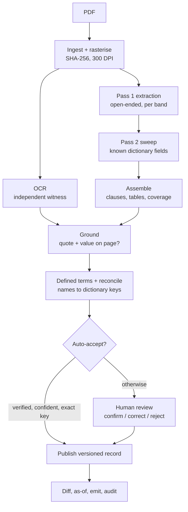

# Credit Agreement Extraction POC — Build Journal

As of 2026-09-21. How the proof of concept was built, step by step: decisions, pipeline, build log,
results, issues, learnings, costs and next steps.

## Summary

We built a working, tested pipeline that turns a scanned credit agreement into source-grounded key-value data, and on a 16-page sample of a real 211-page agreement every auto-accepted value was correct. What is not yet proven is the question the POC was meant to answer: whether an on-prem model (Qwen) inside the bank performs well enough, and on the whole document.

|  | Status |
| --- | --- |
| Pipeline | All 17 build milestones of the spec implemented; 129 automated tests pass with networking disabled |
| Test document | Albemarle A&R Credit Agreement (2022), public SEC exhibit, 211 pages, clean render plus a simulated degraded scan |
| Accuracy (16-page sample, hosted Claude Opus 5) | Auto-accepted values 43/43 correct (clean) and 42/42 (degraded); grounding never verified a value that was not on the page |
| Caveat | The golden set is AI-verified, not human-verified, so the figures are not valid for governance sign-off |
| On-prem model | Adapter for vLLM/Ollama built and tested against a simulated server; no real Qwen call made yet |
| Full document | Not run on the on-prem model |
| API spend | About $16 for the whole POC |
| Handover | Code in the GitHub repository; runbook `WORKPLACE.md` |

## Starting point: the spec and its review

The project began with a handover spec (`credit-agreement-extraction-HANDOVER.md`) for a credit-risk pipeline: extract everything from scanned facility agreements, map it to a growing field dictionary, attach confidence and source grounding, route uncertain values to people, and diff agreement versions. Production must run inside the bank on a self-hosted model; a public frontier model is allowed only on public test documents.

A design review found five blocking gaps, which became Rev 2 of the spec:

1. **Grounding could not work as written.** Scanned PDFs have no text to check a value against. Fix: an independent OCR stage as the second witness, a verbatim quote on every value, and a tri-state grounding result (verified / not found / not checked).
2. **A licence breach.** `pymupdf` is AGPL. Fix: `pypdfium2`, a licence table, and a CI licence gate.
3. **Dictionary poisoning.** Auto-adding fuzzy matches as aliases would make one wrong match permanent (e.g. Consolidated EBITDA vs Consolidated Adjusted EBITDA). Fix: fuzzy matches only propose aliases; a confusable-pairs list; human approval.
4. **Evaluation could not run when scheduled.** The golden set needed dictionary keys that did not exist yet, and 50 labels are too few to measure a 5–15 point model gap. Fix: a seed dictionary at milestone 1, defined metrics, confidence intervals.
5. **The on-prem risk was tested last.** Fix: bring a real local model and degraded scans into the first slice.

The review also added cross-page assembly with a completeness check, tiling so small print is not downscaled, a failure and retry policy, typed values (`Decimal`, units, currency), instance keys for repeated fields, provenance on every output, and review records.

## Key decisions

| Decision | Choice | Why |
| --- | --- | --- |
| POC scope | Milestones 1–8 first: a measured vertical slice on one document | The spec's 17 milestones build a production system; the POC question is narrower |
| What the POC must prove | Extraction on a model that can run inside the bank (option B) | A frontier-only result says nothing about production viability |
| Sequencing (changed) | Frontier model first, on-prem deferred (option C) | The development machine had no usable GPU; the model slot stays config-only |
| Frontier model | Claude Opus 5 (`claude-opus-5`) | Strongest practical ceiling at half the top tier's price; supports images and structured output |
| Model gateway | One `extract()` seam with an adapter per provider; Anthropic SDK directly, plain HTTP for vLLM/Ollama | LiteLLM hid the stop reasons and structured-output behaviour the failure policy depends on (recorded as spec Rev 2.1) |
| Test data | Albemarle 2022 A&R (211 pages) plus a degraded-scan variant made with a fixed seed | A clean HTML-to-PDF render is not a scan; accuracy is reported on both |
| Golden set | Drafted from the PDF's own text, never from model output; verified separately | Keeps the benchmark independent of the system under test |
| Cost discipline | Every paid run approved first; free work done before paid work | Paid runs were batched at the end |
| Where production runs | On-prem, self-hosted model | Real agreements must never reach a hosted model |

## Pipeline flow

A document passes through twelve stages; only extraction and enrichment call a model, and every value must survive the grounding gate before it is accepted without review.

The `cae extract` command runs ingest through publish in one go; each stage can also be run on its own.

| Stage | What it guarantees |
| --- | --- |
| Ingest | Inputs are stored by hash and never overwritten; a dictionary snapshot is pinned per run |
| OCR | Every page has an independent reading, used for grounding, completeness and header/footer detection |
| Pass 1 | The model reads each page band with no dictionary, so it does not stop at a checklist |
| Pass 2 | The model is asked which known fields are present; agreement or disagreement with pass 1 is recorded |
| Assemble | Band overlaps merged, clauses stitched across pages, every page gets a coverage record |
| Ground | A value is verified only if its quote is on the page and the value is in both quote and page text |
| Reconcile | Names map to dictionary keys through exact, alias, defined-term or fuzzy tiers, behind type and confusable-name gates |
| Review | Every human decision is an audit record and feeds aliases and golden rows |
| Publish / diff | Write-once revisions per version; diffs align clauses by content, not number |

## Build log, step by step

The milestones were built in this order; each row says what was built and how it was checked.

| Step | Milestone | What was built | How it was checked |
| --- | --- | --- | --- |
| 1 | Skeleton + contracts | Pydantic data contracts, `models.yaml`, seed dictionary (27 fields, 17 core), versioned prompts, CLI stubs, licence gate, hash-pinned requirements | 33 tests; licence gate passed |
| 2 | Ingest + rasterise | Content-addressed store, 300 DPI rendering, write-once run records, degraded-scan generator | Real 211-page PDF ingested clean (~30 s) and degraded (~2 min) |
| 3 | OCR | Tesseract per page with cache, text-layer probe, OCR accuracy report | Degraded scan: mean word-F1 0.912 vs true text; worst pages were near-blank |
| 4 | Model gateway + tiling | Anthropic adapter with typed failures; page bands cut at OCR line gaps | One live call on the cover page: correct date, CUSIP, parties |
| 5 | Pass 1 extraction | Per-band extraction, response cache, retry and re-tiling policy | 10 pages × 2 variants, 0 failures; pricing grid 20/20 |
| 6 | Assemble | Header/footer removal learned from OCR margins, overlap merging, clause stitching, coverage records | Duplicated grid row and 5 duplicate fields removed; coverage ≥ 98.9% |
| 7 | Grounding | Quote locator tolerant of OCR noise, value check, routing tiers, table cell checks | Scored against the true text: 0 missed errors on both variants |
| 8 | Golden set + eval | 69 rows drafted from the PDF text with a self-check; recall, precision, Wilson intervals, verification tiers | First provisional recall 97.3%; AI-verified rows labelled as such |
| 9 | Reconciliation | Exact / alias / fuzzy mapping, type and confusable gates, instance rules (dictionary v2), party roles, table rows as fields | Precision on golden keys 100% before pass 2 |
| 10 | Defined terms | Definitions, collective terms, usages across all 211 pages from OCR, legal-name resolution | "the Company" resolved to a Borrower; "Bank of America" to "Bank of America, N.A." |
| 11 | Pass 2 | Schema-hinted sweep, merge with agreement tracking, value guidance (dictionary v3) | Labelled recall rose from 86% to 100% (clean) |
| 12 | Enrichment + approval | AI-drafted business meanings for filtered new entries; human-only approval of aliases and entries | 15 drafts for $0.18, all pending |
| 13 | Review loop | CSV export of everything flagged; ingest writes audit records, new revisions, alias proposals, golden rows | 74 items exported for the degraded run |
| 14 | Versioned records | Write-once publish, history, as-of queries | Margin and commitments queried as of a date |
| 15 | Version diff | Content-aligned clause matching, field and table diffs, comparability warnings | Clean vs degraded of the same version: 0 table changes, 4 low-confidence field changes |
| 16 | Compare + on-prem adapter | Side-by-side report with paired McNemar test; vLLM/Ollama adapter; `check-model` | Adapter tested against a simulated server; end-to-end test with a fake Qwen |
| 17 | Hand-off + audit | `emit()` of accepted values only; audit zip with sha256 manifest | 42 values emitted, 53 withheld pending review; 69-file audit bundle |

After the milestones: a one-command `cae extract`, the on-prem runbook, a rewritten README, and a leak-scan
script (`scripts/export_bundle.py`) that was used to verify a clean copy of the project by installing and
re-running it from scratch.

## Results

On the final configuration every value the pipeline accepted without review was correct, on both the clean and the degraded scan; the gap that remains is completeness, not correctness.

| 66 golden values, 15 extracted pages | Clean render | Degraded scan |
| --- | --- | --- |
| Value found anywhere | 100% | 100% |
| Value under the right dictionary key (labelled recall) | 100% (95% CI 94.5–100%) | 95.5% (87.5–98.4%) |
| Mapped values that are correct (precision on golden keys) | 98.8% of 81 | 97.6% of 84 |
| Auto-accepted values that are correct | 100% of 43 (91.8–100%) | 100% of 42 (91.6–100%) |
| Grounding verified a value not on the page | 0 | 0 |
| Pricing grid cells in the right place | 20/20 | 20/20 |
| Commitment schedule: 12 lenders sum to $1.5bn, shares to 100% | pass | pass |

How the key numbers moved as the pipeline improved (clean render):

| Stage reached | Labelled recall | Auto-accepted precision |
| --- | --- | --- |
| Reconciliation only | 78.4% | not yet measured |
| + table rows as fields, 6 more pages | 86.2% | not yet measured |
| + pass 2 (dictionary v2) | 95.4% | 95.2% |
| + golden-set fix (second borrower) | 95.5% | 97.6% |
| + pass 2 with value guidance (v3), legal-name resolution | 100% | 100% |

Caveats that apply to every figure:

- The golden set was drafted from the PDF text and verified by an AI, not a person; the eval labels every report "not valid for governance sign-off".
- The thresholds were tuned on the same 16 pages they are scored on; unseen pages may do worse.
- All results come from a hosted frontier model; the on-prem model has not been measured.
- Page 24 could not be extracted: the hosted model's output filter blocked a benign "Defaulting Lender" definition.

The full record, with every intermediate table, is in `docs/POC_RESULTS.md`.

## Issues found and how they were fixed

Most issues surfaced only when a stage ran on the real document or when results were scored against the true text; the tests were then extended so each could not come back.

| # | Issue | Found by | Fix |
| --- | --- | --- | --- |
| 1 | `$50,000,000` in a prompt broke template rendering | First live call | Escaped as `$$`; test that every prompt renders |
| 2 | Wrong SDK call (`with_raw_response.parse` does not exist) | First live call | Direct `messages.parse`; request id from the response |
| 3 | pdfium renders one pixel off the computed size | Tests on a synthetic PDF | Tolerance of ±1 px |
| 4 | Tesseract had to compile from source (~1 hour) | Install | Built OCR and tiling code in parallel with the install |
| 5 | Browser headers/footers and page numbers extracted as content | Inspecting raw output | Furniture patterns learned from OCR page margins |
| 6 | Band overlaps duplicated table rows and fields | Inspecting raw output | One-to-one overlap matching, row de-duplication |
| 7 | Pages were never stitched to each other | Code review of assembly | Cross-page continuation joins |
| 8 | 17 correct values sent to review on the degraded scan | Grounding vs truth | Out-of-order matching for wrapped table rows, padded windows, punctuation-tolerant references; digits still exact |
| 9 | The model's value was not inside its own quote ("Exhibit 10.1" from "EX-10.1") | Grounding | Prompt v2: value must be an exact substring of the quote |
| 10 | A tiling change left a 21 px footer sliver as a third band | Call count rose 20 → 28 | Evenly sized bands, cuts snapped only within the overlap |
| 11 | One-word dictionary names matched unrelated fields ("Minimum Collateral Amount" → security) | Reviewing mappings | Containment only for multi-word names |
| 12 | Page 24 blocked by the hosted model's content filter | Pass 1 | Classified as `blocked`, not retried, routed to review |
| 13 | Monotonic check failed a lender schedule | Table checks | Monotonic only for level grids; rows-sum-to-total for schedules |
| 14 | Pass 2 returned headings as values ("Non-Payment") and one was auto-accepted | Auto-accepted precision metric | Label-echo gate; value guidance in dictionary v3 |
| 15 | "Bank of America" judged wrong though it is what the page says | Eval | Definitions read from OCR of all pages; legal-name resolution |
| 16 | Golden set missed the Belgian Borrower | Pass 2 found it | Golden row added; `borrower` made repeatable |
| 17 | A one-number clause change was not flagged; footnote marks created 26 fake table changes | Real diff of clean vs degraded | Number comparison; footnote-mark stripping in labels |
| 18 | Cost summaries overwrote each other and mixed prompt versions | Compare report | Cost computed from recorded calls; per-invocation summaries |
| 19 | `publish`, `history`, `asof` deleted by an edit | Fresh-install check of a clean copy | Restored; test that every documented command exists |
| 20 | Clean copy omitted page manifests, so grounding could not re-run | Fresh-install check | Manifests kept, only images excluded |
| 21 | Product REST queries failed: SQLite refused the connection from the HTTP worker thread | `cae serve` then POST `/queries/top_lenders` | Share one connection with `check_same_thread=False` and a lock; test `run()` from a second thread. Direct `dispatch()` tests stay on one thread and do not catch this |

## Learnings

The single most useful design choice was an independent second reading of every page: it turned "the model is confident" into "the value is on the page", and it caught more of our own bugs than any test.

1. **Measure against truth, not against the model.** A clean PDF's text layer gave free ground truth for the degraded scan; every grounding change was scored as missed errors vs false alarms, so no tuning could quietly make the gate unsafe.
2. **The number governance needs is auto-accepted precision.** Overall precision mixed in values that were already going to review; the metric of values no human sees exposed the one real escape ("Non-Payment").
3. **Many "model errors" were not model errors.** The Belgian Borrower was right and the golden set wrong; "Bank of America" was exactly what the page said. Read the page before blaming the model.
4. **An AI checking an AI is not verification.** Drafting and checking the golden set with the same model family missed the second borrower; the eval now keeps AI-verified results visibly separate.
5. **The dictionary has to say what a value is, not just what a field is.** Pass 2 improved sharply only after value guidance ("the grace period, never the heading") was added.
6. **The document defines its own vocabulary.** "The Company", "Threshold Amount", "Bank of America" only resolve through the agreement's definitions, which can be read from OCR of every page at no model cost.
7. **Clause numbers are unreliable.** The Albemarle body numbers sections differently from its table of contents, so diffs must align on content.
8. **Real-data checks beat unit tests for integration bugs.** A fresh install of a clean copy found deleted commands and a missing file that 128 passing tests did not.
9. **Hosted models add a failure mode production will not have.** A content filter blocked a benign legal definition; on-prem avoids that but brings calibration and JSON-reliability risks instead.
10. **One 15-page run cannot settle recall.** Pass 2 labelled three benchmark rates in one run and not the next; decisions need the full document and repeated runs.

## Costs

The whole POC used about $16 of API credit across 291 model calls; a full 211-page run with both passes would cost about $59 per variant on the hosted model.

| Run | Calls | Cost (USD) |
| --- | --- | --- |
| Pass 1, prompt v1 (10 pages × 2 variants) | 40 | 3.16 |
| Pass 1, prompt v2 (16 pages × 2 variants, incl. blocked page 24) | 82 | 5.34 |
| Pass 2 with dictionary v2 | 76 | 3.56 |
| Pass 2 with dictionary v3 | 76 | 3.62 |
| Business-meaning drafts | 15 | 0.18 |
| Two early test calls | 2 | ~0.14 |
| **Total** | **291** | **~16.00** |

These figures are computed from each response's token counts at Opus 5 list price ($5 per million input, $25 per million output tokens); the console bill is authoritative. Measured unit cost: $0.28 per page for both passes. On-prem Qwen has no API cost; its cost is GPU time.

## Handover and next steps

On-prem Qwen on the 16 sample pages, scored and compared against the hosted baseline, is the remaining model check.

The repository contains the code and the processed Albemarle store (page images, OCR, extractions, the accepted handoff, and the JSON data products). `.gitignore` keeps out API keys (`.env`) and local tooling. Result provenance is kept: each run records its model id, and the golden set records that it was checked by a model. `scripts/export_bundle.py` can still build and leak-scan a zip copy.

Accepted values are also exposed as data products. `cae products build` writes the entity model and the JSON products; `cae serve` and `cae mcp` answer only queries listed in `src/credit_extract/products/register.py`. See the README section "Data products".

1. Clone the repository; install from `requirements-prod.txt`; install Tesseract; set `CAE_ENVIRONMENT=prod`.
2. Serve Qwen with vLLM or Ollama; fill `model_name`, `api_base`, `licence` in `models.yaml`; enable it.
3. `cae check-model onprem_candidate` — one call; `WORKPLACE.md` lists fixes for each failure.
4. `cae extract` on the 16 sample pages, then `cae eval` and `cae compare` against the hosted run `20260921T094008Z-67a88b`.
5. Recalibrate `AUTO_ACCEPT_CONFIDENCE` from the on-prem model's auto-accepted precision before trusting auto-acceptance.
6. Run the full 211 pages; re-check grounding thresholds on the 195 pages they were not tuned on.
7. `cae products build` on the accepted handoff, then `cae serve` or `cae mcp` for downstream use.

Open decisions for people, not code:

- [ ] A named person completes the golden-set checklist, so accuracy numbers become quotable
- [ ] Dictionary owner signs off snapshots v2 and v3 and reviews the 15 drafted meanings
- [ ] Decide whether net leverage is the total-leverage field, and whether the facility fee is the commitment-fee field
- [ ] Decide whether a benchmark-rate value is the rate option's name or the underlying benchmark (e.g. SONIA)
- [ ] Governance classifies the system (model vs human-validated assist) before real agreements are used
- [ ] Rotate the API key used for the POC
